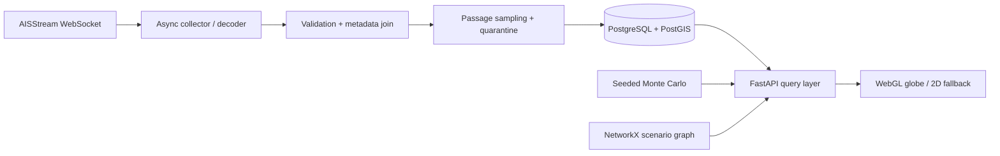

# Meridian — Maritime Intelligence

**A geospatial data engineering and decision-support project by Zachary Amachee.**

[**Launch the 3D globe**](https://meridian-api-production-24fe.up.railway.app/) · [Portfolio case study](https://zachetc.github.io/work/meridian.html) · [Architecture](docs/architecture.md) · [API reference](docs/api-reference.md) · [Data quality](docs/data-quality.md)

Meridian ingests marine Automatic Identification System (AIS) messages, validates and samples observed cargo/tanker positions around **28 strategic maritime passages**, stores observation and vessel state in **PostgreSQL/PostGIS**, and makes location-based intelligence available through a **FastAPI service and interactive WebGL globe**. It also includes two **explicitly illustrative** decision-support tools: a seeded Monte Carlo disruption-cost model and a NetworkX route graph.

> **Coverage and accuracy:** The collector subscribes to a global AIS receiver network, **not a complete global ship census**. Positions are genuine observations when the upstream collector is connected; vessel samples can be sparse, delayed, or absent. The network model is not a navigation service, and cost results are scenarios—not actual losses or predictions.

## Explore the application

The [live interactive dashboard](https://meridian-api-production-24fe.up.railway.app/) provides:

| Feature | Implementation | Important limitation |
| --- | --- | --- |
| **3D maritime globe** | Globe.gl / Three.js with a 2D Leaflet fallback | External map textures and JavaScript must load in the browser |
| **Chokepoint explorer** | 28 curated passage coordinates and approximate radius-based study areas | A point near a passage does not prove transit |
| **AIS vessel observations** | Server-side AISStream ingestion, vessel metadata joins, bounded spatial samples | At most 10 displayed vessels per passage; not a complete population |
| **Vessel inspection** | MMSI, observed coordinates, timestamp, speed and course where reported | AIS attributes may be unavailable, old, or inaccurate |
| **Refresh & collector indicators** | Dashboard polls selected passage approximately every 60 seconds while visible | Refreshing does not guarantee a new upstream position |
| **Disruption sensitivity model** | Reproducible 4,000-trial seeded Monte Carlo model | User assumptions, not event-specific probabilities |
| **Route disruption example** | NetworkX shortest paths on an illustrative shipping graph | Simplified topology, not actual voyage routing |

### Why this matters

A global AIS data stream is not itself useful analytics. Meridian is designed around the engineering work needed to turn noisy event data into defensible operational context: **event-time validation, vessel-identity joins, spatial scoping, idempotent observations, selective persistence, provenance, freshness indicators, retention, and reproducible models**.

## System design



The collector and API run in the same supervised Python service, with PostgreSQL/PostGIS as durable storage. The collector is optional in local development and enabled in a configured Railway environment. Browser users do **not** need the AISStream credential or private API token. See the [architecture and data-flow guide](docs/architecture.md) for the boundaries and deployment topology.

## Technology

**Python 3.12 · FastAPI · asyncio · websockets · httpx · Pydantic · PostgreSQL · PostGIS · asyncpg · NetworkX · pytest · Globe.gl / Three.js · Leaflet · Docker · Railway · GitHub Actions**

## Repository map

```text
.
├── README.md                        # Overview, setup, limitations
├── .env.example                     # Names of local settings; no secrets
├── .gitignore
├── .github/workflows/backend.yml    # Python tests + disposable PostGIS CI
├── backend/
│   ├── Dockerfile
│   ├── railway.json
│   ├── requirements.txt
│   ├── meridian/
│   │   ├── service.py               # API startup and optional collector supervisor
│   │   ├── api.py                   # Public demo + protected operational endpoints
│   │   ├── dashboard.html           # 3D globe, vessel samples and scenario UI
│   │   ├── collector.py             # AISStream WebSocket ingestion
│   │   ├── aisstream.py             # AIS envelope decoding and metadata matching
│   │   ├── ingestion.py             # Normalization and Fintraffic adapter
│   │   ├── sampling.py              # Passage-aware persistence cohorts
│   │   ├── store.py                 # Database writes / deduplication / quarantine
│   │   ├── traffic.py               # Bounded spatial read models
│   │   ├── retention.py             # Seven-day sampled archive maintenance
│   │   ├── model.py                 # Seeded disruption-cost simulation
│   │   ├── graph.py                 # Illustrative routing topology
│   │   └── passage_catalog.json     # 28 passage reference points
│   ├── sql/                         # Versioned PostgreSQL/PostGIS migrations
│   └── tests/                       # Unit and optional DB integration tests
├── docs/
│   ├── architecture.md
│   ├── api-reference.md
│   ├── data-quality.md
│   └── railway-deployment.md
└── examples/
    ├── README.md
    └── scenario_request.json
```

## Run the tests locally

From the repository root:

```bash
python -m venv .venv
# macOS/Linux: source .venv/bin/activate
# Windows PowerShell: .venv\Scripts\Activate.ps1
pip install -r backend/requirements.txt
PYTHONPATH=backend pytest backend/tests -q
```

For **PowerShell**, the last command is:

```powershell
$env:PYTHONPATH = "backend"
python -m pytest backend/tests -q
```

The PostGIS integration test runs only when `DATABASE_URL` points to a **disposable testing database**; never run it against a production archive. The GitHub Actions workflow provisions its own PostGIS service to exercise the database tests.

## Run the application

A running Meridian service requires **PostgreSQL with the PostGIS extension**, `DATABASE_URL`, and `API_TOKEN`. The service runs SQL migrations at startup. To enable streaming, additionally supply `AIS_PROVIDER=aisstream`, `RUN_COLLECTOR=1`, and a private `AISSTREAM_API_KEY`.

Copy [`.env.example`](.env.example) into your local environment or configure the variables with your hosting provider. **Never commit the populated file or a provider key.**

For an existing provisioned PostGIS database:

```bash
cd backend
python -m meridian.service
```

Visit `http://localhost:8000/` for the dashboard and `/health` for service liveness. If `RUN_COLLECTOR` is not enabled, the globe can render passage locations, but live AIS sampling is not active. See [deployment documentation](docs/railway-deployment.md) for the Railway settings, storage considerations, and verification steps.

## API surface

The dashboard uses bounded, **public, read-only** routes. More detailed observations and operational functions use a separate **Bearer-protected** API.

| Method | Path | Access | Purpose |
| --- | --- | --- | --- |
| GET | `/` | Public | Interactive globe dashboard |
| GET | `/health` | Public | Process health; **not** feed health |
| GET | `/public/passages` | Public | Passage reference catalog |
| GET | `/public/traffic?scope=chokepoint1` | Public | Bounded recent AIS sample within a passage |
| POST | `/public/scenario` | Public | Reproducible, non-persisted cost scenario |
| GET | `/public/network` | Public | Simplified route analysis |
| GET | `/vessels` | Bearer | Collector summary / optional watched MMSIs |
| GET | `/traffic` | Bearer | Scoped traffic or MMSI queries |
| GET | `/history` | Bearer | Timestamped archived vessel positions |
| POST | `/subscriptions` | Bearer | Request MMSI tracking |
| POST | `/scenarios` | Bearer | Persisted cost-scenario run |
| GET | `/network` | Bearer | Network analysis |

See [the API reference](docs/api-reference.md) and [sample requests](examples/README.md). Do not expose an operational Bearer token in client-side JavaScript.

## Data integrity and operational limitations

- **Event time:** preserve the source AIS timestamp rather than replacing it with retrieval time.
- **Entity resolution:** match position reports with known static identity metadata by MMSI. Some valid reports cannot be classified and are not retained.
- **Sampling:** current implementation accepts cargo/tanker observations into at most 10 vessel cohorts per passage per source hour, plus explicit tracked MMSIs. The on-globe sample is **not** a full vessel census.
- **Freshness:** API summary reports whether collector status has been updated recently; old individual vessel locations are never assumed current.
- **Storage:** observations are de-duplicated by MMSI and event time; implausible jumps are quarantined. Archive maintenance retains sampled observations for approximately seven days while latest state may persist.
- **Uncertainty:** AIS cannot reliably prove cargo manifests, shipment value, a vessel’s home country, or a disruption's economic impact.
- **Scale:** a starter Railway database volume is not designed for indefinite full-fidelity worldwide archiving. Collection can pause on configured storage budgets.

For design details, operational risks, and limitations read [data quality and integrity](docs/data-quality.md).

## Engineering verification

The repository includes unit tests covering AIS parsing, bounded spatial queries, authentication, retention, deterministic simulation, route closures, and selected PostGIS interactions. GitHub Actions runs tests with Python 3.12 and an ephemeral PostGIS service.

> A successful CI run validates selected code paths; it does not prove complete AIS receiver coverage, every live ship's location, WebGL performance in every browser, or economic forecast accuracy.

## Roadmap

See [ROADMAP.md](ROADMAP.md) for the distinction between implemented functionality, gaps, and possible future extensions. Priorities include stronger visual-level verification, more expressive data provenance, and higher-quality operational metrics.

---

**Author:** Zachary Amachee · [GitHub](https://github.com/Zachetc) · [Portfolio](https://zachetc.github.io/)  
**License:** [MIT](LICENSE) (third-party data sources and map imagery retain their respective terms).  
**Disclaimer:** This is a research and portfolio data product, **not** a navigation, maritime safety, trading, or investment system.
