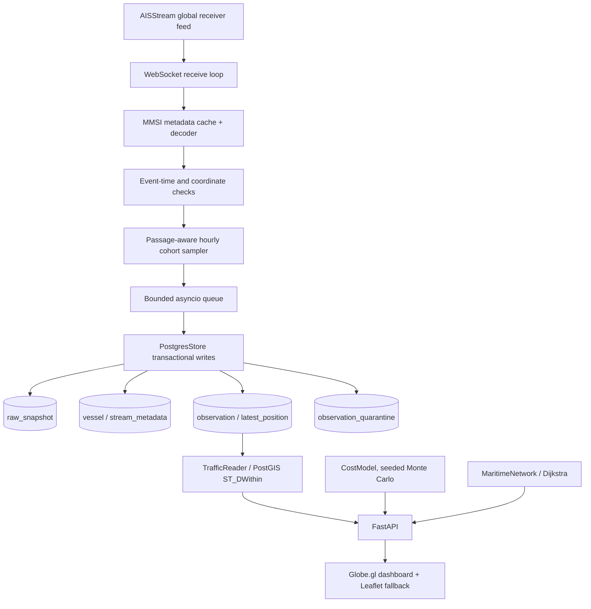

# Meridian architecture and engineering decisions

## Design objective

Meridian separates **observed vessel facts** from **business assumptions**. AIS packets report positions and limited metadata; they do not establish a cargo manifest, operational route plan, or economic loss. The application therefore uses an event-processing pipeline for vessel observations and two separate deterministic analytical demonstrations.

## Component diagram

### Collection process

- `service.py` runs migrations, starts FastAPI and optionally starts the collector within the same process. A failed collector can terminate the supervised service so the failure is not silently ignored.
- `collector.py` opens a WebSocket subscription covering global geographic bounds. **Global subscription is not synonymous with global receiver coverage.**
- `aisstream.py` maintains bounded MMSI metadata and pending-position caches, and only normalizes eligible cargo/tanker observations when identity metadata permits classification.
- `sampling.py` chooses hourly vessel cohorts near the configured 28 passage centers. It caps new members to 10 per passage/hour, plus explicitly watched MMSIs, and avoids duplicate minute-level state writes.
- `store.py` transactionally stores normalized vessel identity, latest known position, sampled history, and quarantined implausible jumps. `observation` uses the composite key `(mmsi, observed_at)`.
- `retention.py` removes expired archive history after seven days, while protecting latest-state and tracking tables. Storage budget checks include PostgreSQL write-ahead logs.

### Query process

- `TrafficReader.query()` constructs a **bounded** response for an approved passage, the Baltic region, or one MMSI. For passage queries, `ST_DWithin` tests observed coordinates against a radius in meters.
- The global summary intentionally does **not** return all stored vessel positions. Public passage responses cap samples at 10 records.
- `TrafficReader.summary()` caches counts for about 15 seconds and reports connection freshness, ingest status, storage pause state, and persisted position counts.
- `TrafficReader.history()` reads an MMSI's timestamped archived positions, max 1,500 points per request. This sampled history does not imply continuous trajectory coverage.

### Presentation

The dashboard is served by FastAPI from `backend/meridian/dashboard.html`. It loads Globe.gl from a public CDN to render a Three.js globe. A Leaflet map provides the 2D alternative. The dashboard reads `/public/passages` and `/public/traffic` without needing a browser-accessible provider key. It also calls `/public/scenario` and `/public/network`.

The dashboard polls the currently selected passage about every 60 seconds while visible. **This is a refresh interval, not the age of the AIS observation.** Markers reflect original observed coordinates and timestamps. If data does not arrive or a passage sample is empty, the UI should never invent a vessel.

## Trust boundaries

| Boundary | Rules |
| --- | --- |
| AIS provider → backend | Provider secret only inside server environment variables |
| HTTP browser → public API | Public endpoints restricted to passage catalog, bounded passage samples, and stateless illustrative models |
| Operations client → protected API | Constant-time Bearer token comparison via `API_TOKEN` |
| Application → PostGIS | SQL parameters for vessel identifiers, radii and timestamps |
| Live data → simulations | No implication that modeled cost assumptions came from AIS |
| Disk usage | Hard operational risk addressed with soft budget pause, hourly sampling and archival retention |

## Key tradeoffs

**Sampling versus completeness.** The project favors bounded storage and understandable UI over pretending that it archives every vessel position. Samples are not suitable for traffic census or statistical inference.

**Event time versus ingest time.** AIS event timestamps are preserved as the coordinate's observation time. The receipt time measures pipeline latency; it is not substituted for vessel motion time.

**Quarantine versus location correction.** The backend detects a >100 km/h position jump across short observation intervals. Suspect measurements can be quarantined, but the original observation coordinates are not moved to a plausible offshore location.

**Simple routing versus maritime route planning.** The NetworkX graph demonstrates how chokepoint closures affect shortest paths over preselected illustrative nodes. It does not model ship drafts, canals, sea states, port clearance, vessel-specific routing or actual transit time.

**Deterministic financial simulation versus forecasting.** CostModel uses a fixed-seed pseudo-random generator and explicit scenario assumptions to make results reproducible. The probabilities and expenses are not fitted to observed incidents.

## Persistent tables

- `vessel`: MMSI-keyed identity metadata, category and reported destination.
- `stream_metadata`: static AIS attributes seen by the streaming decoder.
- `latest_position`: most recent accepted position and JSON payload per MMSI, optimized for spatial reads.
- `observation`: bounded, event-time-keyed historical position archive.
- `raw_snapshot`: persisted source batches referenced by archival observations.
- `observation_quarantine`: suspect motion events and reasons.
- `collector_status`: recent collector metrics and connection flags.
- `tracking_subscription`: explicitly watched MMSIs.
- `scenario_run`: recorded protected-API scenario executions.
- `archive_maintenance` / `schema_migration`: operational bookkeeping.

SQL schema sources: [backend/sql/](../backend/sql/).

## Verification and operations

Follow [deployment instructions](railway-deployment.md) and run `PYTHONPATH=backend pytest backend/tests -q` from the repository root. Storage, receiver freshness and first-hand browser rendering are separate operational gates from the build succeeding.
